<div align="center">

# 🏦 SecureBank

### Modern Banking Management System

A full-stack banking application with a beautiful UI, real-time notifications,
secure JWT authentication, and a managed **Supabase (PostgreSQL)** database.

**[🚀 LIVE — https://vaultora2.netlify.app](https://vaultora2.netlify.app/)**

[](https://vaultora2.netlify.app/)
[](https://react.dev/)
[](https://flask.palletsprojects.com/)
[](https://supabase.com/)
[](LICENSE)

</div>

---

## 📸 Screenshots

> _Attach your app screenshots in the `screenshots/` folder with the filenames below — they will appear here automatically._

### 🔐 Authentication

| Login | Register |
|:---:|:---:|
| 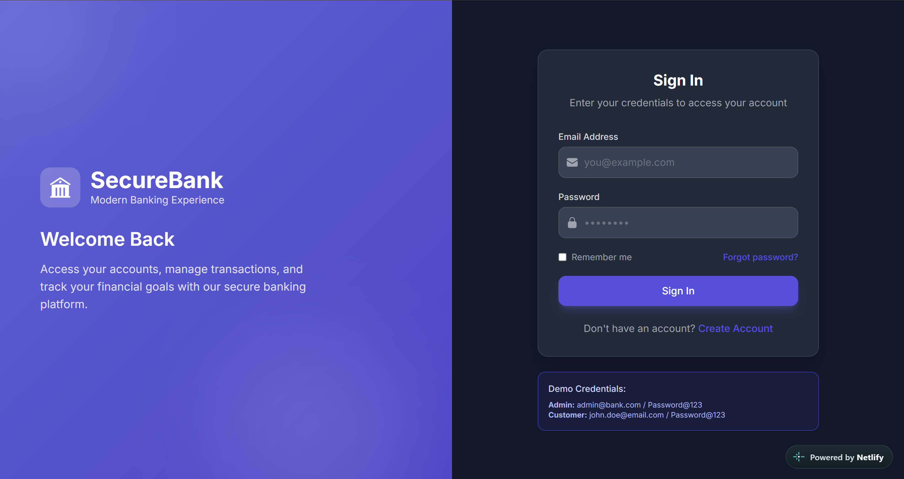 | 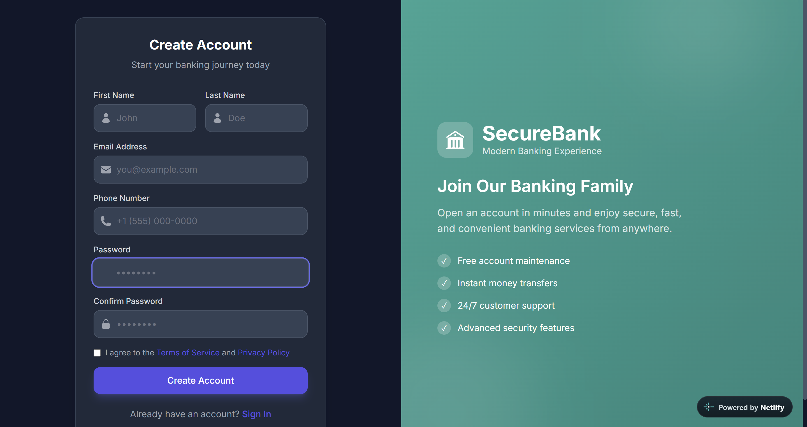 |

### 🏠 Customer Dashboard

| Dashboard | Accounts |
|:---:|:---:|
| 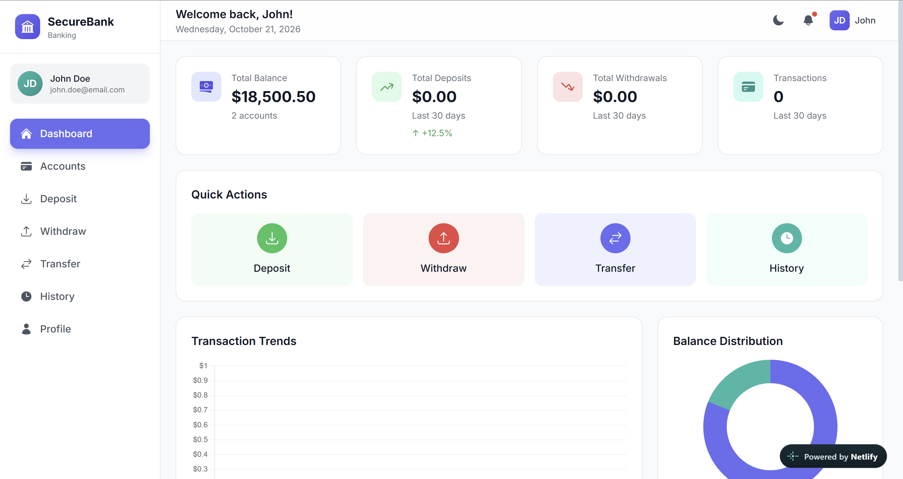 | 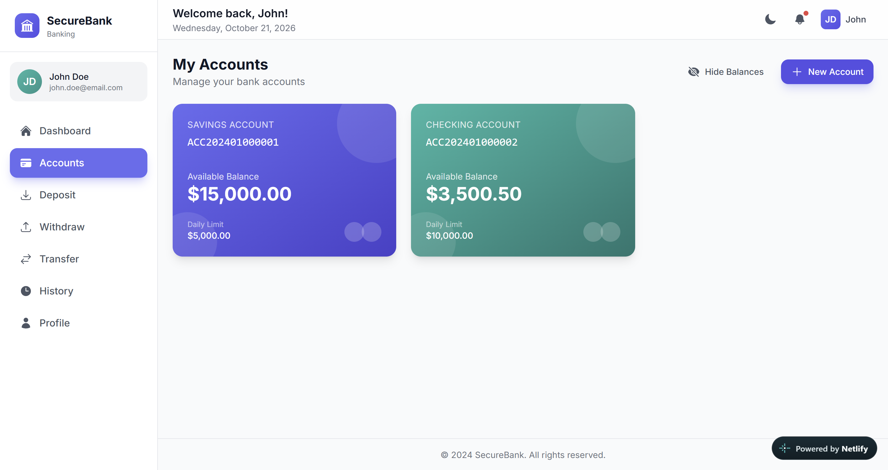 |

### 💰 Transactions

| Deposit | Withdraw |
|:---:|:---:|
| 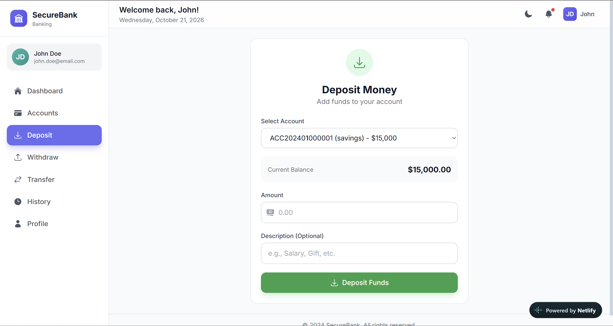 | 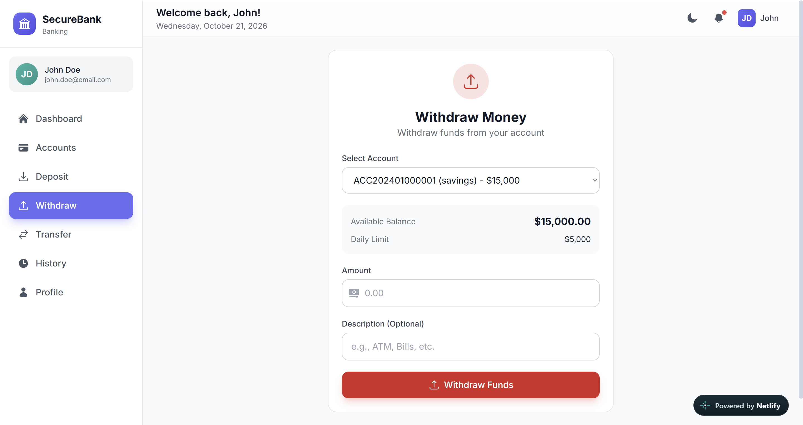 |

| Transfer | Transaction History |
|:---:|:---:|
| 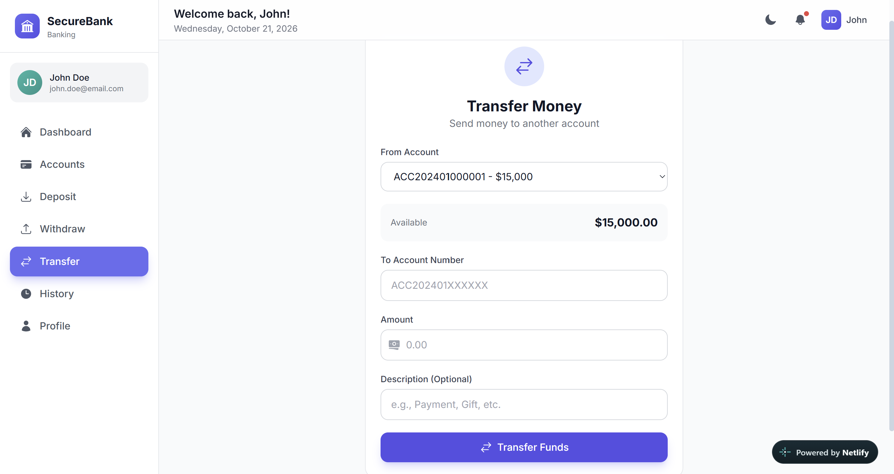 | 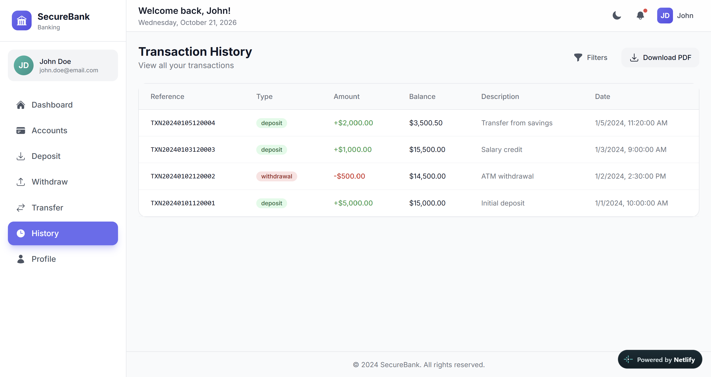 |

### 🔔 Notifications & Settings

| Notifications | Settings |
|:---:|:---:|
| 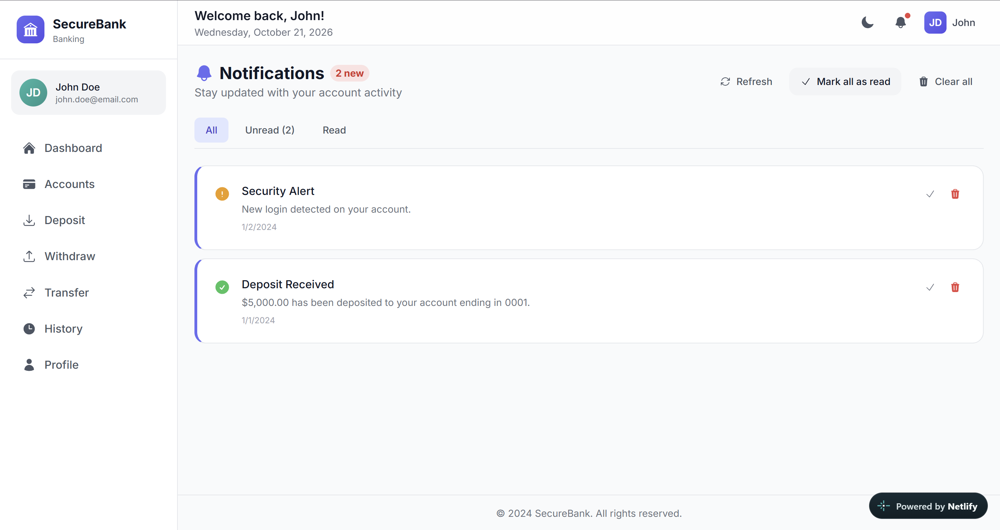 | 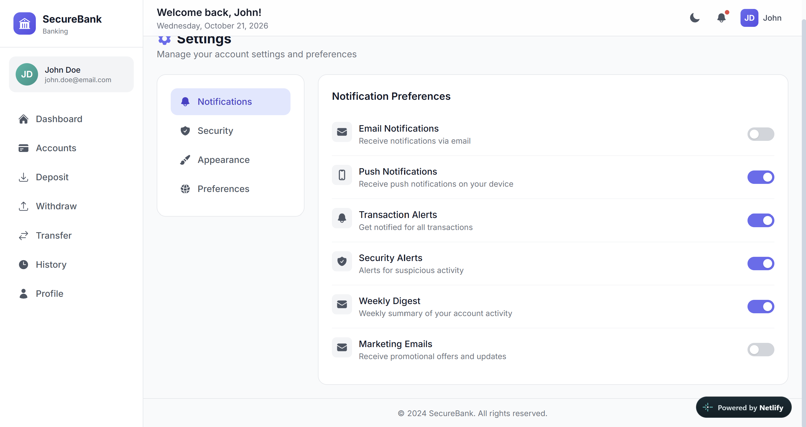 |

### 🛡️ Admin Panel

| Admin Dashboard | User Management |
|:---:|:---:|
| 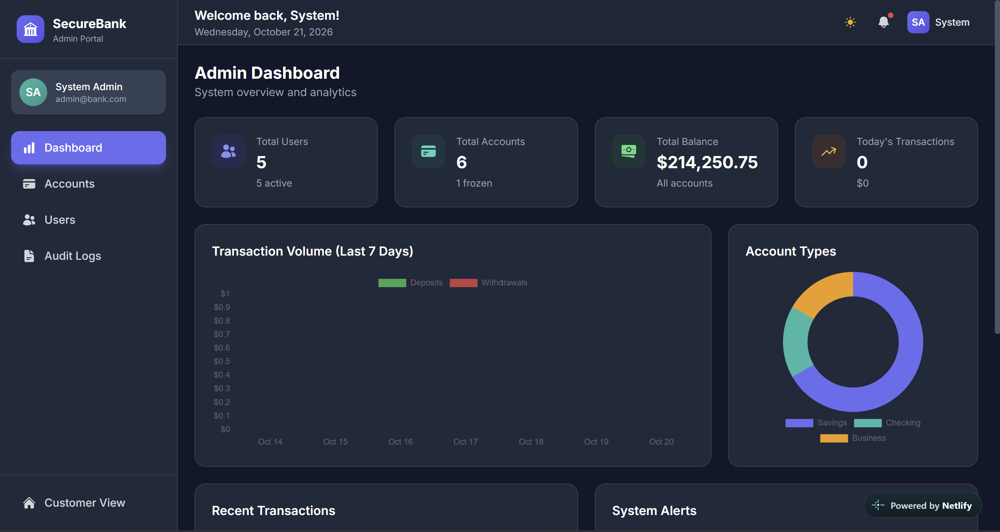 | 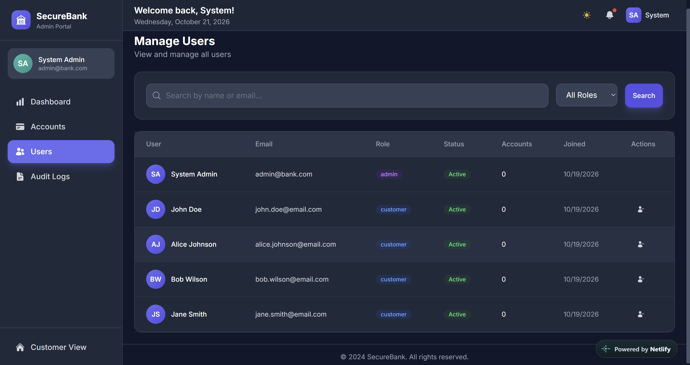 |

---

## ✨ Features

| Category | Highlights |
|----------|-----------|
| 👤 **User Management** | Registration & login with JWT · profile management · password change with validation · role-based access (Admin / Customer) |
| 💳 **Accounts** | Savings / Checking / Business accounts · instant account creation · freeze status · daily transaction limits |
| 💰 **Transactions** | Deposits · withdrawals (balance + limit checks) · transfers between accounts · filterable history · PDF statements |
| 🔔 **Notifications** | Instant alerts for deposits, withdrawals, transfers · notification center · unread badge |
| 🛡️ **Admin** | Dashboard stats & charts · user activate/deactivate · freeze/unfreeze accounts · complete audit logs |
| 🎨 **UI** | Dark/light theme · multi-currency display (USD, EUR, GBP, INR, JPY) · animated with Framer Motion · fully responsive |

---

## 🚀 Tech Stack

| Layer | Technologies |
|-------|--------------|
| **Frontend** | React 18 · Vite · Tailwind CSS · Framer Motion · Chart.js · React Hot Toast · React Router |
| **Backend** | Flask · Flask-JWT-Extended · SQLAlchemy · Flask-Limiter · bcrypt · ReportLab |
| **Database** | Supabase (PostgreSQL 17) · triggers · CHECK constraints · JSONB audit logs |
| **Hosting** | Frontend → Netlify · Backend → Render |

---

## 🔐 Demo Credentials

| Role | Email | Password |
|------|-------|----------|
| 👑 Admin | `admin@bank.com` | `Password@123` |
| 👤 Customer | `john.doe@email.com` | `Password@123` |
| 👤 Customer | `jane.smith@email.com` | `Password@123` |
| 👤 Customer | `bob.wilson@email.com` | `Password@123` |
| 🧊 Customer (frozen) | `alice.johnson@email.com` | `Password@123` |

---

## 🛠️ Getting Started

### Prerequisites
- Python 3.10+
- Node.js 18+
- A free [Supabase](https://supabase.com) project

### 1. Database (Supabase)

Create a project at [supabase.com](https://supabase.com), open the **SQL Editor**
in the dashboard, and run [`database/supabase_schema.sql`](database/supabase_schema.sql).
This creates all tables, triggers, and seed data (5 demo users, 6 accounts,
sample transactions).

> 💡 Get your connection string from **Project Settings → Database → Connection pooling** (session mode, IPv4-friendly).

### 2. Backend

```bash
cd backend
python -m venv venv
venv\Scripts\activate        # Windows
source venv/bin/activate     # Linux/Mac
pip install -r requirements.txt
copy .env.example .env        # edit with your Supabase credentials
python run.py                 # runs at http://localhost:5000
```

> ⚠️ **Restricted networks (college/corporate WiFi):** outbound port 5432 is often
> blocked, which prevents direct Supabase connections. For offline development set
> `DATABASE_URL=sqlite:///bank_dev.db` in `.env` — the app creates its schema automatically.

### 3. Frontend

```bash
cd frontend
npm install
npm run dev                   # runs at http://localhost:5173 (proxies /api → :5000)
```

---

## ☁️ Deployment

This project deploys as two free-tier services:

**Backend → Render** (Netlify cannot run Flask)

1. Push this repo to GitHub
2. On [Render](https://dashboard.render.com): **New → Blueprint** → select the repo
   (uses [`render.yaml`](render.yaml))
3. When prompted enter:
   - `DB_PASSWORD` → your Supabase database password
   - `CORS_ORIGINS` → your Netlify site URL (`https://vaultora2.netlify.app`)

**Frontend → Netlify**

1. On [Netlify](https://app.netlify.com): **Add new site → Import an existing project**
   (uses [`netlify.toml`](netlify.toml))
2. Set the environment variable `VITE_API_URL` → your Render service URL
3. Redeploy after setting the variable

---

## 📄 API Overview

| Endpoint | Method | Description |
|----------|--------|-------------|
| `/api/auth/register` | POST | Register a new user |
| `/api/auth/login` | POST | Login (JWT access + refresh tokens) |
| `/api/auth/me` | GET | Current user profile |
| `/api/accounts` | GET / POST | List / create bank accounts |
| `/api/accounts/summary` | GET | Aggregate balances |
| `/api/transactions/deposit` | POST | Deposit funds |
| `/api/transactions/withdraw` | POST | Withdraw funds |
| `/api/transactions/transfer` | POST | Transfer between accounts |
| `/api/transactions/history` | GET | Paginated, filterable history |
| `/api/transactions/statement` | GET | Download PDF statement |
| `/api/transactions/analytics` | GET | Spending analytics |
| `/api/notifications` | GET | List notifications |
| `/api/admin/dashboard` | GET | Admin statistics |
| `/api/admin/users` | GET | User management |
| `/api/admin/logs` | GET | Audit logs |

---

## 📁 Project Structure

```
bank-app/
├── backend/
│   ├── app/
│   │   ├── models/          # SQLAlchemy models (PostgreSQL)
│   │   └── routes/          # REST API endpoints
│   ├── run.py               # Server entry point
│   └── requirements.txt
├── frontend/
│   ├── src/
│   │   ├── components/      # Reusable UI components
│   │   ├── context/         # Auth, Theme, Currency contexts
│   │   ├── pages/           # App pages (customer + admin)
│   │   └── services/        # Axios API client
│   └── package.json
├── database/
│   ├── supabase_schema.sql  # PostgreSQL schema + seed data
│   └── ...
├── screenshots/             # App screenshots (README)
├── netlify.toml             # Frontend deployment config
└── render.yaml              # Backend deployment config
```

---

## 🔒 Security

- JWT authentication with access + refresh tokens
- bcrypt password hashing (12 rounds)
- Rate limiting on auth endpoints (Flask-Limiter)
- CORS whitelist · input validation · SQL injection prevention (SQLAlchemy ORM)
- Server-side balance & daily-limit enforcement + DB CHECK constraints

> **Note:** Demo users store a `plain_password` column for educational purposes — remove before any real-world use. Never commit `.env` files (already excluded via `.gitignore`).

---

## 📜 License

Released under the MIT License.

---

<div align="center">

**⭐ Star this repo if you found it useful!**

</div>

---

**Disclaimer:** This application is for educational/demonstration purposes only. Do not use for actual banking operations.
